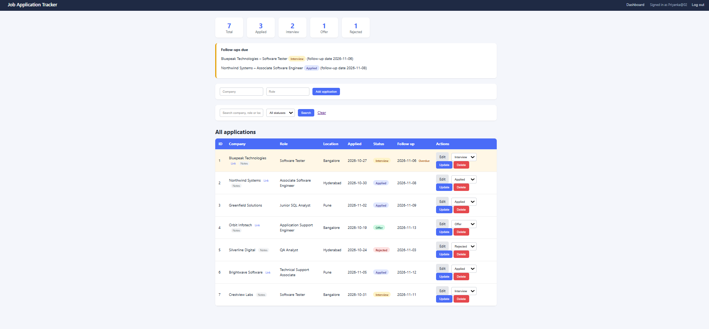
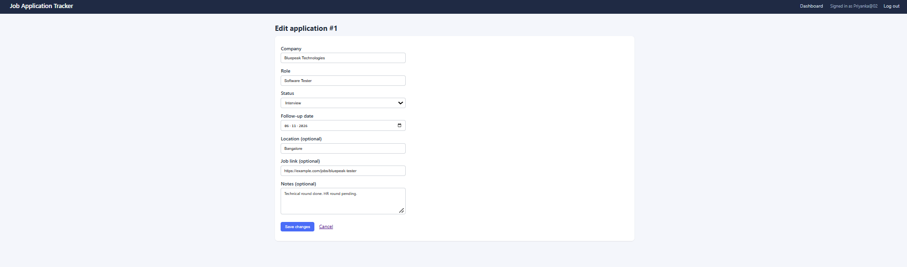

# Job Application Tracker (Web)

A full-stack Java web application to track job applications during a job hunt. It runs locally and stores data in MySQL.

The first version of this idea was a console app: [job-application-tracker](https://github.com/Priyanka2-dhar/job-application-tracker).

## Screenshots

**Dashboard**



**Login**


**Edit application**



## Features
- Login and logout, with passwords stored as salted PBKDF2 hashes (never as plain text)
- Every page is protected by a servlet filter, so you must sign in first
- Add, edit, update status and delete applications
- Dashboard with counts per status (SQL `GROUP BY`)
- "Follow-ups due" list for open applications whose follow-up date has arrived, with overdue rows highlighted
- Search by company, role or location, and filter by status (SQL `LIKE` with prepared statements)
- Optional fields: location, job link and notes
- Server-side validation and a friendly error page

## Tech Stack
- Java 21, Servlets and JSP (Jakarta EE 10), JSTL
- JDBC with MySQL 8
- Maven, Jetty (run from Maven)
- HTML and CSS

## Project Structure
```
src/main/java/com/jobtracker   servlets, DAO classes, filter, utilities
src/main/webapp/WEB-INF/views  JSP pages
src/main/webapp/css            stylesheet
schema.sql                     database tables
```

## How to Run
1. Install JDK 21 or newer, and MySQL 8.
2. Create the database: run `schema.sql` in MySQL Workbench.
3. Copy `db.properties.example` to `db.properties` and enter your MySQL password.
4. Create your login by running the `CreateUser` class once and entering a username and password.
5. Start the server:
   ```
   mvn clean org.eclipse.jetty.ee10:jetty-ee10-maven-plugin:12.0.16:run
   ```
   (In IntelliJ, create a Maven run configuration with that command.)
6. Open http://localhost:9090 and log in.

## Notes
- This is a single-user, local demo. All data is shared by whoever logs in.
- `db.properties` holds your database password and is ignored by Git.

## Future Plans
- A multi-user, online version with sign-up and separate data for each user, deployed to the cloud